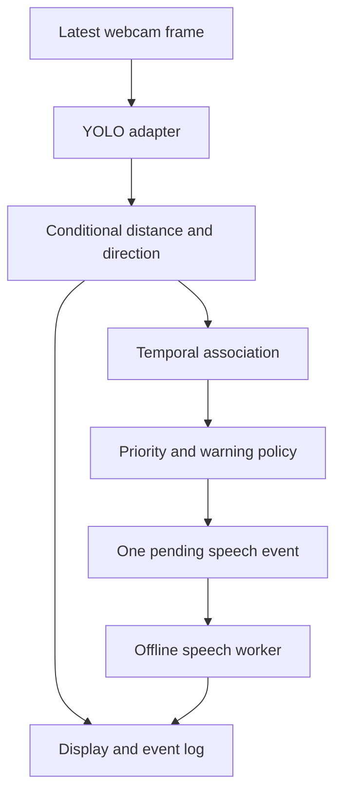

# Smart Obstacle Narrator

A modular Python webcam application for experimental assistive obstacle narration.

**Three honest operating modes:**

| Mode | What works | What it does not establish |
|---|---|---|
| Synthetic demo | Entire display, temporal filtering, priority, logging and speech pipeline with generated boxes | No image understanding or model accuracy |
| Bundled YOLO11n baseline | Person, chair, bicycle and vehicle detection using COCO weights | No custom stairs, poles, barriers or doors |
| Custom model | All eight configured classes after training with your annotated dataset | No guaranteed detection, safe navigation or universally accurate distance |

The software is implemented. A project-specific eight-class trained model is **not** supplied: no real custom dataset was provided. The training notebook and all dataset tools are supplied. Check `docs/VERIFICATION.md` for exactly what was executed.

> Experimental assistive prototype. Detection and distance estimates may be incorrect or delayed. It does not replace a white cane, guide dog, human assistance, or professional mobility aids. It never declares a path safe or directs road crossing.

## Start on Windows 11

Extract the ZIP. Open PowerShell **inside the extracted SmartObstacleNarrator folder**, where this README and pyproject.toml are located. Install Python 3.11 first if it is unavailable.

```powershell
py -3.11 -m venv .venv
.\.venv\Scripts\python.exe -m pip install --upgrade pip
.\.venv\Scripts\python.exe -m pip install -r requirements.txt
```

No PowerShell execution-policy change or activation is needed when using the explicit Python path above.

Test the software without a camera or model:

```powershell
.\.venv\Scripts\python.exe -m smart_obstacle_narrator.app --demo
```

Run the included pretrained baseline with the laptop webcam and offline speech:

```powershell
.\.venv\Scripts\python.exe -m smart_obstacle_narrator.app --baseline
```

Use `--source 1` for another webcam; actual device index varies. Use `--no-audio` to isolate speech problems. `--headless --seconds 20` runs without a window. `--audio-first` runs without a window and attempts startup speech; Ctrl+C exits. The desktop UI is the main keyboard-control interface.

Custom model, after training:

```powershell
.\.venv\Scripts\python.exe -m smart_obstacle_narrator.app --weights models/v1/best_v1.pt
```

Use `--source "C:\Videos\hallway.mp4"` for video replay. A video uses its own source identifier and will not accidentally reuse camera 0 calibration; specify `--camera-id 0` only if the recording was made with that exact calibrated camera, resolution and zoom.

Keys: **Q** quit; **M** mute/unmute; **P** pause/resume; **R** repeat current observation; **H** print help. An active spoken sentence may finish after mute/pause. Pending speech is cleared.

## Architecture



Capture and speech have dedicated workers. Main-thread processing owns decision state. Speech reports actual driver-start callbacks to the main thread; cooldown starts at that callback. Pending events are revalidated against current observations. No unbounded frame or speech queues are used.

See `docs/ARCHITECTURE.md` for data contracts, scoring, and timing. Sources are grouped into concise modules under `src/smart_obstacle_narrator/` rather than one large program.

## Dataset and training

See `docs/DATASET.md`. Final class order is **person, chair, bicycle, vehicle, stairs, pole, barrier, door**. Never reorder class IDs between training and inference.

1. Collect real sessions and annotate all target objects in CVAT.
2. Create a CSV manifest with image, label, group, source columns.
3. Prepare and validate grouped train/validation/test splits.
4. Upload the project ZIP and prepared dataset ZIP to Google Drive.
5. Run `notebooks/01_training.ipynb` in a GPU Colab runtime.
6. Download the immutable model version directory from Drive to local `models/`.
7. Run `notebooks/02_inference.ipynb` independently, or the local app.

Training uses transferred YOLO11n weights, persistent run checkpoints, validation and test metrics, confusion matrices, sample predictions, dataset hashes, model checksums and environment metadata. No important model artifact depends solely on `/content` storage. `docs/TRAINING.md` explains interruption recovery.

## Distance is disabled initially

There is no honest universal meters-from-box-size conversion. `configs/camera.yaml` starts disabled. Use `docs/CALIBRATION.md` to measure a reference object and calibrate. Unknown distance remains unknown in speech and display.

Direction is relative to an unmirrored, forward-facing camera. Keep it in a known orientation. Central-box overlap affects priority but does not prove collision.

## Test and evaluate

```powershell
.\.venv\Scripts\python.exe -m pip install -r requirements-dev.txt
.\.venv\Scripts\python.exe -m pytest -q
.\.venv\Scripts\python.exe -m smart_obstacle_narrator.app --demo --no-audio --headless --seconds 16 --log results/demo.jsonl
.\.venv\Scripts\python.exe -m smart_obstacle_narrator.evaluation results/demo.jsonl --output results/demo_metrics.json
```

Synthetic results measure software behavior only. Silent speech callbacks are not audio measurements. Real-world accuracy, Windows audio, laptop webcam latency and the 15-minute hardware soak remain to be evaluated with your devices and dataset.

## GPU and dependencies

Default device is automatic CUDA when available, CPU otherwise. `--device cpu` forces CPU. A compatible CUDA PyTorch build and NVIDIA driver are required for GPU operation; use the official PyTorch installation selector for your environment. Do not install an arbitrary CUDA wheel merely because the laptop has an NVIDIA sticker.

`requirements.txt` supplies bounded compatibility ranges. `requirements-verified.txt` records the top-level stack exercised in the build environment; it is not a tested Windows lockfile. After confirming your Windows install, record it with:

```powershell
.\.venv\Scripts\python.exe -m pip freeze > results/windows_environment.txt
```

No network is required for baseline inference once dependencies and bundled weights are installed. The Colab notebooks require internet and mounted Drive. Linux audible speech may require eSpeak; Windows uses the installed SAPI voices.

## Outputs and privacy

Logs contain detection boxes, classes, timestamps and warning text; images are not saved by default. `--record results/demo.mp4` explicitly records annotated video; `--snapshot results/final.png` saves the last display. Video recordings use a fixed playback rate and are illustrative: use JSON timestamps for latency measurement. Do not record people without the required consent/permissions.

## Documentation and ownership

- `docs/ARCHITECTURE.md`: interfaces and module/file responsibilities.
- `docs/DATASET.md`: collection, annotation, splits and commands.
- `docs/TRAINING.md`: Drive layout, notebooks, recovery and versions.
- `docs/CALIBRATION.md`: measurement procedure and fallback.
- `docs/EVALUATION.md`: metrics, ground truth and field scenarios.
- `docs/TEAM_AND_GIT.md`: four-member ownership and review workflow.
- `docs/PROJECT_REPORT.md`: academic report with honest result status.
- `docs/PRESENTATION.md`: slide content and speaker notes.
- `docs/VIVA.md`: viva/interview questions and answers.
- `docs/DEMO_SCRIPT.md`: presentation demonstration procedure.
- `docs/TROUBLESHOOTING.md`: common errors and fixes.
- `docs/VERIFICATION.md`: execution evidence and untested boundaries.

License: AGPL-3.0 as included in LICENSE. See THIRD_PARTY_NOTICES.md for upstream model provenance. Do not commit model weights, datasets or private recordings to GitHub; the bundled baseline is for convenient local use and is ignored by Git.
